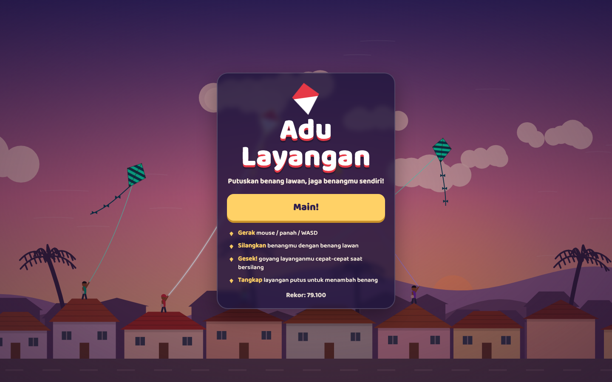
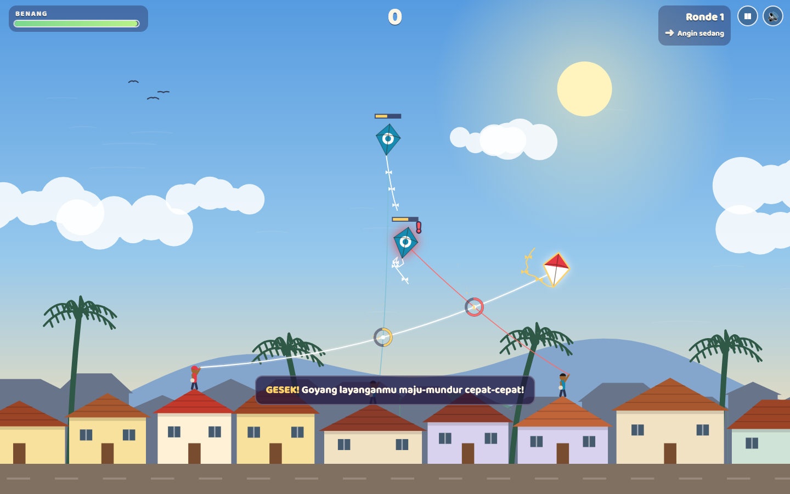
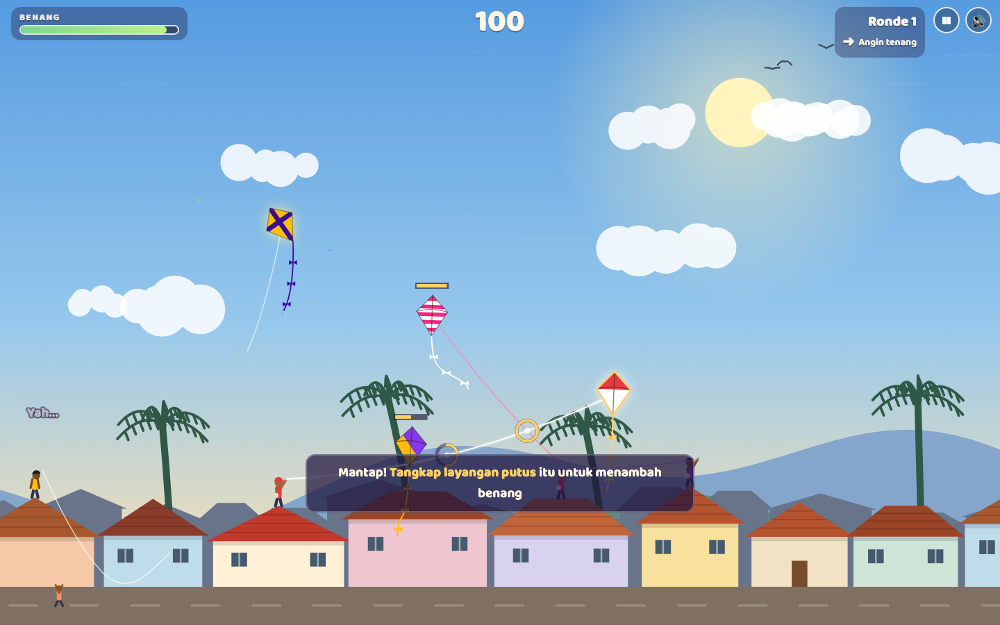
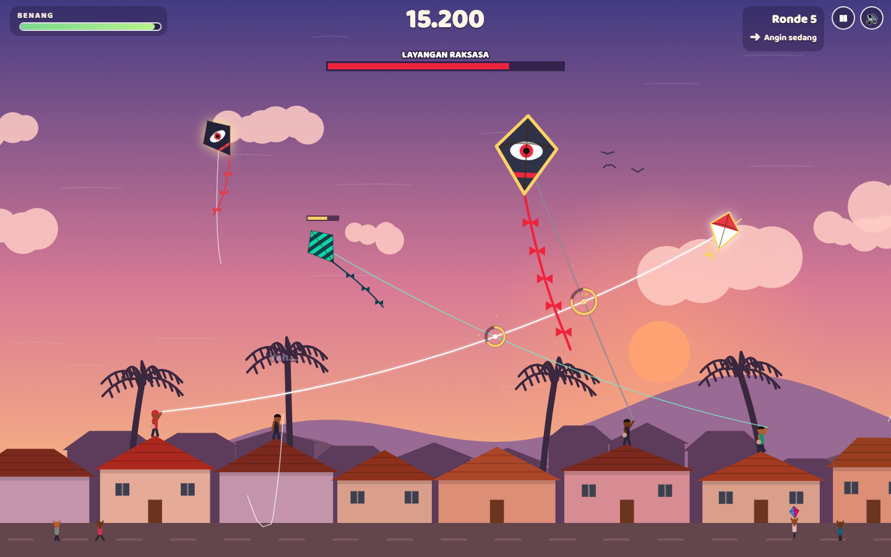
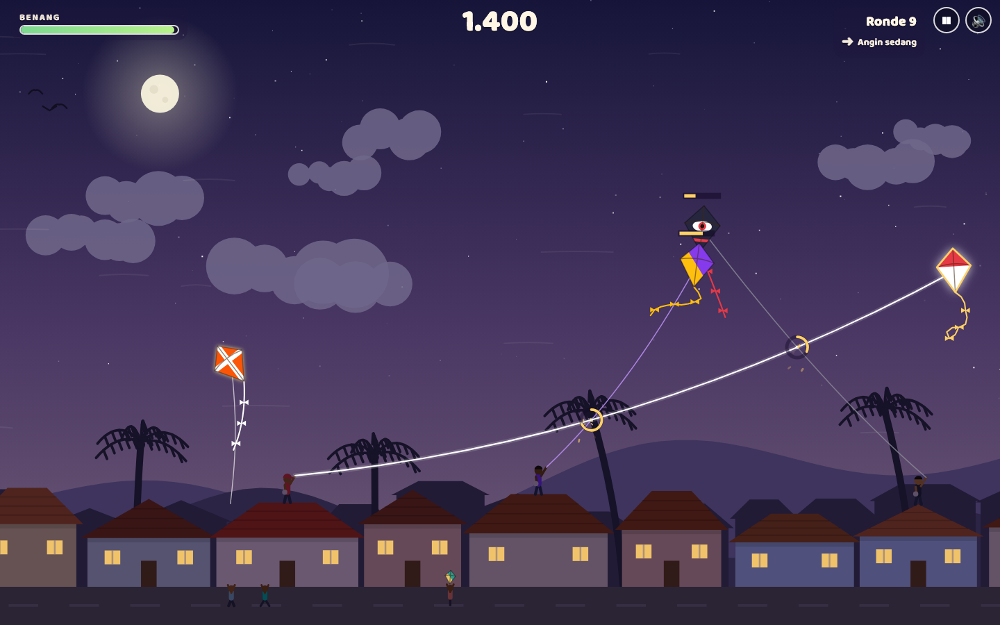
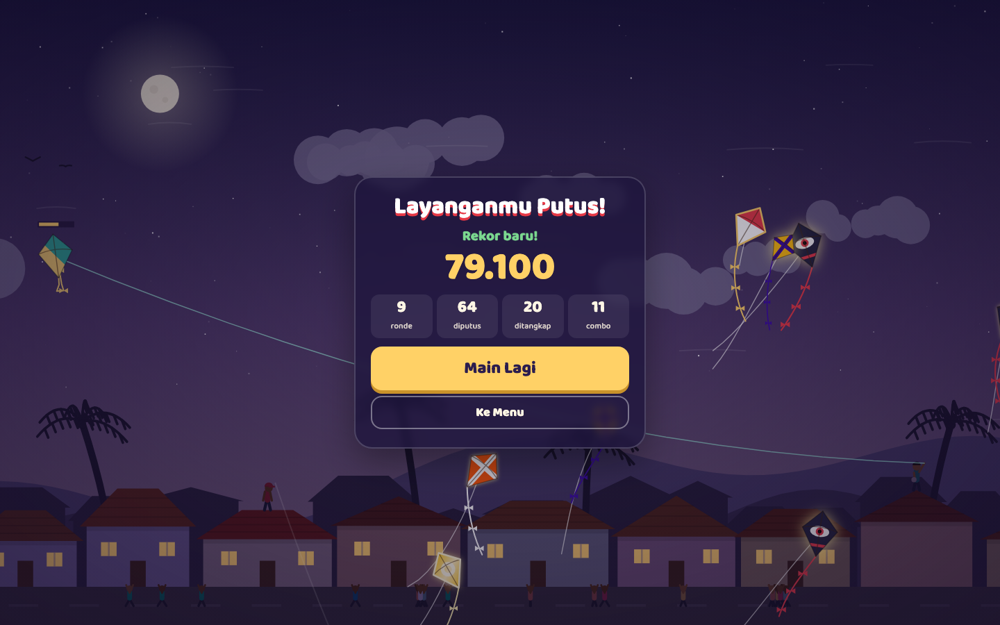
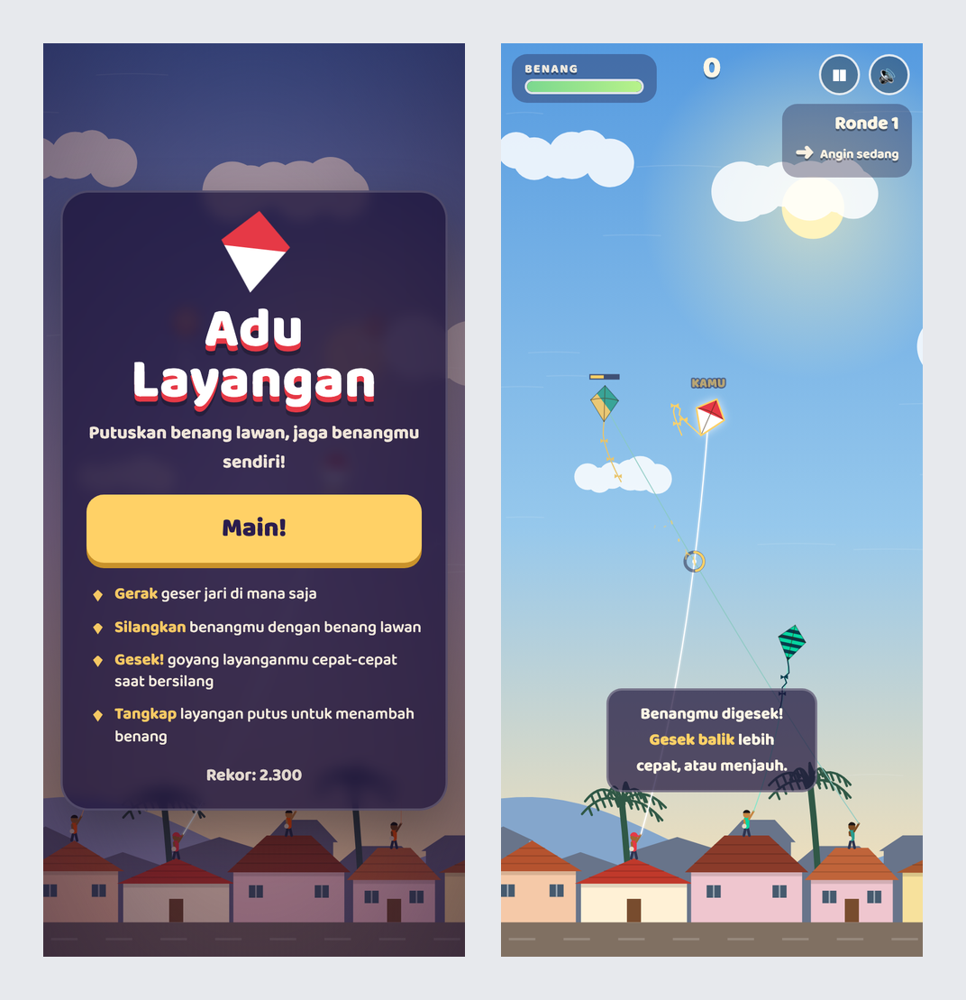

# Adu Layangan

Game adu layangan yang bisa langsung dimainkan di browser. Latarnya genteng kampung waktu sore, dan tugasmu mutusin benang layangan lawan sambil jaga benangmu sendiri biar nggak ikut putus.

Pas main, benangmu tinggal disilangin ke benang lawan, terus layangannya digoyang cepat-cepat buat gesek. Makin tinggi rondenya, lawannya makin jago dan langitnya ganti dari sore ke senja terus malam.

Gamenya statis, cuma pakai HTML, CSS, sama JavaScript biasa tanpa framework.

Link game: https://yahya-nz.github.io/Game-Adu-Layangan/

## Tampilan

**Layar judul**

Di belakang menunya, layangan-layangan udah pada terbang duluan.



**Adu benang**

Benangmu yang putih disilangin ke benang lawan. Titik silangnya ditandain lingkaran yang sekaligus nunjukin sisa benang lawan. Kalau lawan lagi gesek balik, benangnya jadi merah dan ada tanda seru di layangannya.



**Layangan lawan putus**

Layangan yang putus melayang jatuh bareng sisa benangnya. Tangkap buat nambah benang dan poin, sebelum keduluan anak-anak yang ngejar di jalan.



**Layangan Raksasa**

Muncul tiap 5 ronde. Benangnya jauh lebih kuat dari lawan biasa, dan sisa benangnya kelihatan di bar atas.



**Ronde malam**

Makin tinggi rondenya, langitnya makin gelap. Bintang sama bulan keluar, lampu rumah-rumah juga nyala.



**Layanganmu putus**

Kalau benangmu yang putus, permainan selesai. Skor, ronde, jumlah layangan yang diputus dan ditangkap, sama combo terbaik ditampilin di sini.



**Tampilan di HP**



## Fitur

- Adu benang: silangin benangmu ke benang lawan, terus gesek sampai putus. Gesek balik juga bisa nahan serangan lawan.
- Jenis lawannya makin beragam tiap ronde, dari yang santai, yang gerakannya lincah, sampai yang terus ngincer benangmu.
- Tiap 5 ronde muncul Layangan Raksasa. Kadang ada Layangan Emas juga, bonusnya besar kalau keburu diputus sebelum kabur.
- Layangan putus bisa ditangkap buat nambah benang dan poin, tapi anak-anak di jalan ikut ngejar.
- Combo kalau mutusin beberapa layangan berturut-turut, poinnya dikali.
- Langit ganti dari sore ke senja terus malam seiring ronde naik.
- Rekor skor kesimpen di browser, dan ada tutorial singkat waktu pertama kali main.
- Bisa dimainkan pakai mouse, tombol panah, atau WASD. Responsif, di HP tinggal geser jari.

## Teknologi

- HTML, CSS, dan JavaScript biasa.
- Canvas 2D buat gambar langit, kampung, layangan, sama benangnya.
- Efek suaranya dibikin langsung pakai Web Audio API, jadi nggak ada file audio sama sekali.
- Font Baloo 2 dari Google Fonts.

## Struktur folder

```text
.
├── index.html             halaman game dan layar menu
├── assets
│   ├── css
│   │   └── style.css      tampilan HUD dan menu
│   └── js
│       ├── util.js        fungsi bantu (matematika, tali, penyimpanan)
│       ├── audio.js       efek suara
│       ├── scene.js       latar: langit, awan, bukit, rumah, orang
│       ├── kite.js        gambar layangan, ekor, dan benang
│       ├── entities.js    layangan pemain, lawan, layangan putus, anak-anak, efek
│       ├── game.js        aturan ronde, adu benang, skor
│       └── main.js        HUD, kontrol, dan loop utama
└── screenshot
```

## Cara menjalankan

1. Clone atau download repo ini.
2. Buka file `index.html` di browser (Chrome, Firefox, Edge, atau Safari).
3. Pastikan konek internet, soalnya fontnya diambil dari Google Fonts. Kalau offline gamenya tetap jalan, cuma tulisannya pakai font bawaan browser.
4. Suaranya baru keluar setelah tombol "Main!" diklik. Mau main tanpa suara? Tekan `M` atau klik tombol suara di kanan atas.

## Cara main

| Aksi | Laptop | HP |
|---|---|---|
| Terbangin layangan | Gerakin mouse, atau tombol panah / WASD | Geser jari di mana aja |
| Jeda | `P` atau `Esc` | Tombol jeda di kanan atas |
| Suara on/off | `M` | Tombol suara di kanan atas |

1. Silangin benangmu (yang putih) ke benang lawan.
2. Goyang layanganmu cepat-cepat selama benangnya masih nyilang. Lingkaran di titik silang nunjukin sisa benang lawan.
3. Kalau ada tanda seru merah, lawan lagi gesek balik. Gesek lebih kencang atau menjauh dulu.
4. Tangkap layangan putus yang jatuh buat nambah benang.
5. Putusin beberapa layangan berturut-turut biar dapet combo.

## Mengubah tingkat kesulitan

Angkanya ada di `assets/js/entities.js`:

- `PLAYER_DMG`: seberapa cepat gesekanmu mutusin benang lawan.
- `ENEMY_DMG`: seberapa cepat gesekan lawan mutusin benangmu.
- `ETYPES`: kekuatan, kecepatan, sama nyawa tiap jenis lawan.
